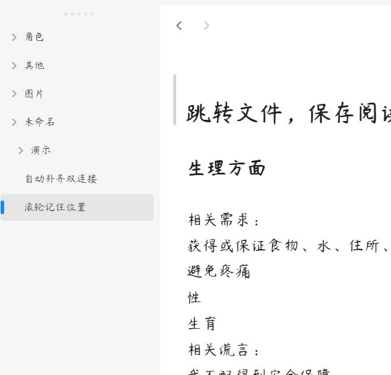

# obsidian-simply-scroll-next

**English** | [简体中文](./README.zh-CN.md)

An Obsidian plugin that remembers how far you scrolled in each Markdown file and takes you back there when you open the file again. Only the scroll position is recorded, not the cursor position. No flickering, no jumping.

**This is a fork of [Simply Scroll](https://github.com/hornatx/simply-scroll) by HornatX, which is no longer maintained. It uses a new plugin id, `simply-scroll-next`, and is installed and released independently of the original. I will keep maintaining it. Issues and PRs are welcome for any problems you run into.**



- **Minimum Obsidian version**: 0.15.0 (not tested on older versions, but it should work in theory)
- **Platforms**: Desktop and mobile (`isDesktopOnly: false`)
- **Settings**: none; it works as soon as it is enabled
- **License**: MIT

---

## ✨ Features

- 📍 **Scroll restore**: records the scroll position of each Markdown file, in Reading view and while editing, and restores it the next time the file is opened from the file explorer, the quick switcher and so on
- 🫥 **Seamless cloaking**: the note stays hidden while the position is applied and then fades in, so you don't see it jump from the top
- 🎯 **Focus suppression**: the editor is kept unfocused while the position is applied, so it can't grab focus and cause a second jump
- 🔗 **Jump targets win** (fixed in simply-scroll-next): when Obsidian opens a file at a specific place (a heading or block link, a search result, back/forward navigation), or navigates within the same file, the plugin leaves positioning to Obsidian
- 🧹 **Self-cleaning data**: renaming a file moves its record, deleting a file removes it, and records of files that no longer exist are removed when the plugin loads

---

## 🚀 Installation

simply-scroll-next and the original plugin (simply-scroll) can't be enabled at the same time. Disable the original plugin before using this one.

### From Community plugins (recommended)

1. In Obsidian, open **Settings → Community plugins** and click **Browse**
2. Search for `simply-scroll-next` (by QuincyLeo)
3. Click **Install**, then **Enable**

### Manual install

```
<Your Vault>/.obsidian/plugins/simply-scroll-next/
├── main.js
├── manifest.json
└── styles.css
```

1. Create the directory `.obsidian/plugins/simply-scroll-next/` inside your vault
2. Run `npm install` in the repo root
3. Edit `TARGET_DIR` at the top of `build.sh` to point at the directory above, then run `./build.sh`. It bundles via esbuild and copies `main.js` / `manifest.json` / `styles.css` for you
4. Enable the plugin in Obsidian under **Settings → Community plugins**

---

## 🖱️ Usage

There is nothing to configure or trigger:

1. Scroll through any Markdown file, in Reading view or while editing. The position is recorded automatically.
2. Open another file, then come back. The view returns to where you left off.

---

## 🏗️ How it works

- **Recording**: a capture-phase `scroll` listener on `window` handles `.cm-scroller`, `.markdown-reading-view` and `.markdown-preview-view`. While you scroll, it stores `currentMode.getScroll()` under the file path at most every 300 ms. `data.json` is written at most every 2 s, and immediately when the active leaf changes, when a recorded file is renamed or deleted, and on unload.
- **Restoring**: the plugin wraps `WorkspaceLeaf.prototype.setViewState`. When a Markdown file with a saved position is opened without a jump target, and the leaf isn't already showing that file, it passes the saved position as `scroll` in the ephemeral state, drops `line` and `cursor`, and sets `focus: false`.
- **Cloaking**: before the file loads, the view's content gets `simply-scroll-hiding` (opacity 0) and the view container gets `simply-scroll-cloaked` (cursor and selection hidden). After it loads, the plugin keeps re-applying the position and removing focus: every frame for 600 ms while Obsidian is starting up, otherwise every 5 ms for 20 ms (with a 200 ms fallback). Then the content fades in over 50 ms.
- **Cleanup**: once the layout is ready, records of files that no longer exist are removed.

---

## ⚠️ Known limitations

- Only Markdown views are handled; positions in PDF, Canvas and other views are not recorded.
- According to the original author, positions within roughly the first 10 lines of a file are not remembered; positions further down are.
- When a file with a saved position opens, its content stays hidden while the position is applied. The original author estimates this makes opening about 40 ms slower, which some people notice.

---

## 🧱 Code layout

```
simply-scroll-next/
├── manifest.json      # Plugin metadata
├── main.js            # esbuild output; the file Obsidian loads (not committed)
├── styles.css         # Cloaking styles; install it alongside main.js
├── package.json       # Build / check scripts
├── tsconfig.json      # TypeScript settings
├── build.sh           # One-shot build + copy to a target vault plugin dir
│
├── src/
│   └── main.ts        # Plugin source: scroll recording, setViewState wrapper, data cleanup
│
├── pics/
│   └── demo.gif       # Demo used in the README
│
├── LICENSE            # MIT
└── README.md / README.zh-CN.md
```

---

## 🛠️ Development notes

- **Bundled build**: source lives in `src/`, and `npm run build` (esbuild) bundles it into the root `main.js`. `obsidian`, `electron` and `@codemirror/*` are marked external
- **One-shot build + distribute**: after editing `TARGET_DIR` at the top of `build.sh`, running it does `npm run build` and copies `main.js` / `manifest.json` / `styles.css` into the target vault's plugin directory
- **package.json scripts**:
  - `npm run build` — esbuild bundle
  - `npm run check` — build + `node --check main.js` (syntax self-check)

---

## 📄 License

MIT © 2026 [HornatX](https://github.com/hornatx) (original Simply Scroll), © 2026 [QuincyLeo](https://github.com/Quincy-Leo) (Quincy-Leo)

See [LICENSE](./LICENSE) for details.
