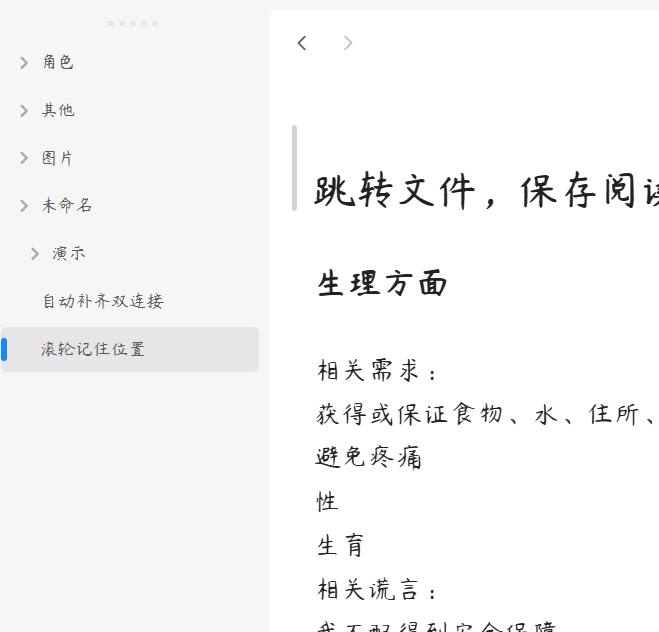

# obsidian-simply-scroll-next

[English](./README.md) | **简体中文**

Obsidian 插件：记住每篇 Markdown 笔记滚动到的位置，再次打开时回到那里。只记录滚动位置，不记录光标位置，打开时不闪烁、不跳动。

**本项目 fork 自 HornatX 的 [Simply Scroll](https://github.com/hornatx/simply-scroll)，原项目已停止维护。新版使用新的插件 id `simply-scroll-next`，独立于原版安装和发布。我会持续维护，有任何使用问题欢迎提issue和PR。**



- **最低 Obsidian 版本**：0.15.0 （未在更低版本测试过，理论上可用）
- **平台**：桌面端和移动端（`isDesktopOnly: false`）
- **设置项**：无，启用即生效
- **协议**：MIT

---

## ✨ 特性

- 📍 **滚动位置恢复**：在阅读视图和编辑视图中记录每篇笔记的滚动位置，下次从文件列表、快速切换等入口打开时自动恢复
- 🫥 **无缝遮罩**：定位期间先隐藏笔记内容，定位完成后再淡入，看不到从顶部跳到目标位置的过程
- 🎯 **焦点抑制**：定位期间不让编辑器获得焦点，避免编辑器抢焦点造成二次跳动
- 🔗 **跳转目标优先**（simply-scroll-next 修复）：Obsidian 带着明确目标打开文件时（标题或块链接、搜索结果、前进/后退），或在同一篇笔记内跳转时，插件不干预，由 Obsidian 自己定位
- 🧹 **数据自动清理**：文件重命名时迁移记录，删除时移除记录，插件加载时清理已不存在的文件的记录

---

## 🚀 安装

simply-scroll-next 和原版插件（simply-scroll）不能同时启用。使用本插件请先关闭原版插件。

### 从官方插件商店安装（推荐）

1. 打开 Obsidian **设置 → 第三方插件**，点击 **浏览**
2. 搜索 `simply-scroll-next`（作者 QuincyLeo）
3. 点击 **安装**，再点击 **启用**

### 手动安装

```
<Your Vault>/.obsidian/plugins/simply-scroll-next/
├── main.js
├── manifest.json
└── styles.css
```

1. 在你的 Vault 下创建 `.obsidian/plugins/simply-scroll-next/` 目录
2. 在仓库根目录执行 `npm install`
3. 编辑 `build.sh` 里的 `TARGET_DIR` 指向上述目录，然后运行 `./build.sh`，它会调用 esbuild 打包并把 `main.js` / `manifest.json` / `styles.css` 拷贝过去
4. 在 Obsidian **设置 → 第三方插件** 中启用插件

---

## 🖱️ 用法

无需配置，也无需手动触发：

1. 在任意 Markdown 笔记中滚动阅读或编辑，滚动位置会被自动记录。
2. 切换到其他笔记再回来，视图会回到上次的位置。

---

## 🏗️ 工作原理

- **记录**：在 `window` 上以捕获阶段监听 `scroll` 事件，只处理 `.cm-scroller`、`.markdown-reading-view`、`.markdown-preview-view`。滚动期间最多每 300 ms 按文件路径保存一次 `currentMode.getScroll()` 的值。`data.json` 最多每 2 s 写入一次；切换活动标签页、有记录的文件被重命名或删除、插件卸载时立即写入。
- **恢复**：插件包装了 `WorkspaceLeaf.prototype.setViewState`。打开一篇有记录的 Markdown 笔记时，如果没有跳转目标，当前标签页显示的也不是这篇笔记，就把记录的位置作为临时状态（ephemeral state）里的 `scroll` 传入，去掉 `line` 和 `cursor`，并设置 `focus: false`。
- **遮罩**：文件加载前，给视图内容加上 `simply-scroll-hiding`（透明度 0），给视图容器加上 `simply-scroll-cloaked`（隐藏光标和选区）。加载后反复重新应用滚动位置并移除焦点：Obsidian 启动阶段每帧一次、持续 600 ms；之后每 5 ms 一次、持续 20 ms（200 ms 兜底）。最后内容在 50 ms 内淡入。
- **清理**：布局就绪后，删除对应文件已不存在的记录。

---

## ⚠️ 已知限制

- 只处理 Markdown 视图，PDF、Canvas 等其他视图的位置不会记录。
- 据原作者说明，笔记前 10 行左右以内的位置记不住，再往下的位置都能恢复。
- 打开有记录位置的笔记时，内容会在定位期间隐藏。原作者估计这会让打开慢约 40 ms，对延迟敏感的话能感觉到。

---

## 🧱 代码结构

```
simply-scroll-next/
├── manifest.json      # 插件元数据
├── main.js            # esbuild 构建产物，供 Obsidian 加载（不入库）
├── styles.css         # 遮罩样式，需与 main.js 一起安装
├── package.json       # 构建、检查脚本
├── tsconfig.json      # TypeScript 配置
├── build.sh           # 一键构建 + 拷贝到目标 Vault 插件目录
│
├── src/
│   └── main.ts        # 插件源码：滚动记录、setViewState 包装、数据清理
│
├── pics/
│   └── demo.gif       # README 演示动图
│
├── LICENSE            # MIT
└── README.md / README.zh-CN.md
```

---

## 🛠️ 开发说明

- **打包构建**：源码放在 `src/`，`npm run build`（esbuild）把它打包成根目录的 `main.js`；`obsidian`、`electron`、`@codemirror/*` 作为外部依赖不打包
- **一键 build + 分发**：编辑 `build.sh` 顶部的 `TARGET_DIR` 后运行，会执行 `npm run build` 并把 `main.js` / `manifest.json` / `styles.css` 拷贝到目标 Vault 的插件目录
- **package.json 脚本**：
  - `npm run build` — esbuild 打包
  - `npm run check` — build + `node --check main.js`（语法自检）

---

## 📄 License

MIT © 2026 [HornatX](https://github.com/hornatx)（原版 Simply Scroll）、© 2026 [QuincyLeo](https://github.com/Quincy-Leo) (Quincy-Leo)

详见 [LICENSE](./LICENSE)。
